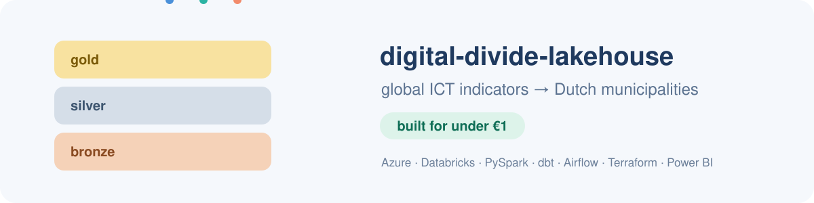
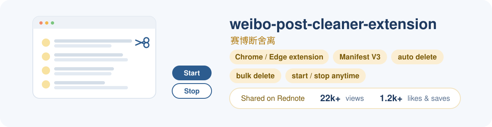

  

  

 

  

<table>
  <tr><td><b>Languages&nbsp;&amp;&nbsp;web</b></td><td><code>Python</code> <code>SQL</code> <code>R</code> <code>JavaScript</code> <code>HTML</code> <code>Node.js</code> <code>Express</code></td></tr>
  <tr><td><b>Data&nbsp;engineering</b></td><td><code>PySpark</code> <code>dbt</code> <code>ETL / ELT</code> <code>REST APIs</code> <code>medallion architecture</code> <code>incremental loads</code> <code>star schema</code> <code>SCD2</code> <code>H3 spatial joins</code></td></tr>
  <tr><td><b>Cloud&nbsp;&amp;&nbsp;platforms</b></td><td><code>Azure (ADLS Gen2, Key Vault)</code> <code>Microsoft Fabric</code> <code>Databricks (Jobs, Asset Bundles, SQL warehouse, serverless)</code> <code>Delta Lake (MERGE)</code> <code>Unity Catalog (Volumes)</code> <code>AWS (EC2, S3, SQS, SNS)</code></td></tr>
  <tr><td><b>Orchestration&nbsp;&amp;&nbsp;DevOps</b></td><td><code>Airflow</code> <code>Docker</code> <code>Terraform</code> <code>Git / GitHub</code> <code>GitHub Actions</code> <code>CI/CD</code></td></tr>
  <tr><td><b>Databases</b></td><td><code>SQL Server</code> <code>MySQL</code> <code>DynamoDB</code></td></tr>
  <tr><td><b>Governance&nbsp;&amp;&nbsp;testing</b></td><td><code>data governance</code> <code>pytest</code> <code>dbt tests</code> <code>ruff</code> <code>gitleaks</code></td></tr>
  <tr><td><b>Analytics&nbsp;&amp;&nbsp;BI</b></td><td><code>Power BI (DAX)</code> <code>Tableau</code> <code>D3.js</code> <code>Excel</code> <code>Jupyter</code></td></tr>
  <tr><td><b>Data&nbsp;science&nbsp;&amp;&nbsp;ML</b></td><td><code>pandas</code> <code>NumPy</code> <code>SciPy</code> <code>Matplotlib</code> <code>scikit-learn</code> <code>XGBoost</code> <code>TensorFlow</code> <code>Keras</code> <code>PyTorch</code> <code>LSTM</code> <code>NLP</code> <code>BERT / Transformers</code></td></tr>
  <tr><td><b>Certifications</b></td><td><code>Microsoft Certified: Fabric Data Engineer Associate (DP-700)</code> <code>AWS Academy Cloud Foundations</code></td></tr>
</table>

 

  

  

  <a href="https://github.com/ellach123/digital-divide-lakehouse">↗ View on GitHub</a>

  

  <a href="https://github.com/ellach123/weisy-daily-desk">↗ View on GitHub</a>

  

  <a href="https://github.com/ellach123/weibo-post-cleaner-extension">↗ View on GitHub</a>

  

  <a href="https://github.com/ellach123/conway-game-of-life">↗ View on GitHub</a>&nbsp; · &nbsp;<a href="https://ellach123.github.io/conway-game-of-life/">▶ Play in browser</a>

  

  <a href="https://github.com/ellach123/europe-expo-compass">↗ View on GitHub</a>

